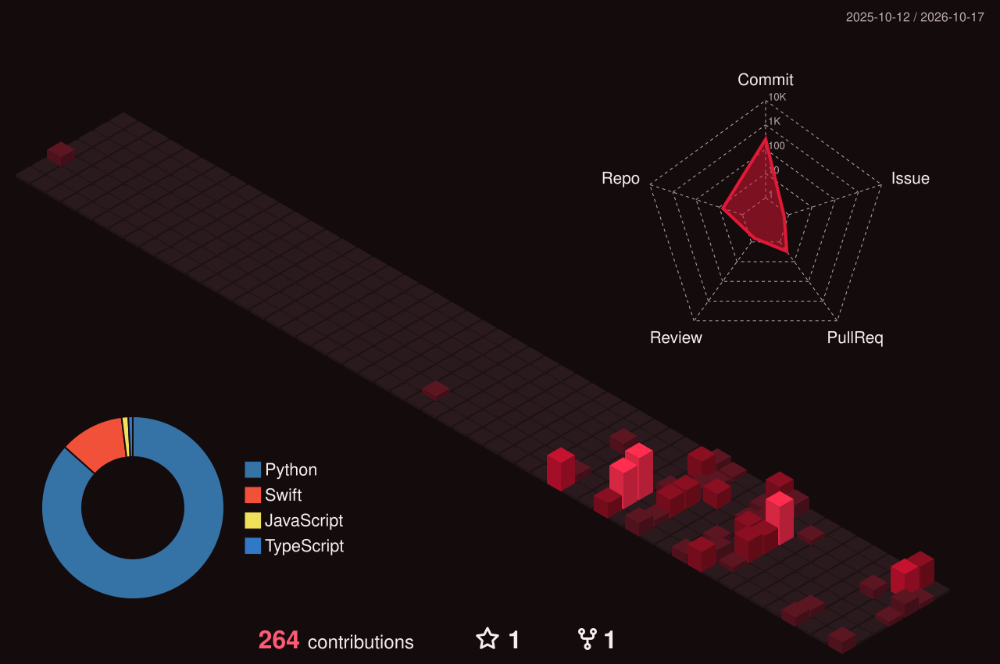

<a href="https://dhana-site.vercel.app">
  
</a>

<p align="center">
  <a href="https://dhana-site.vercel.app">
    
  </a>
</p>

<p align="center">
  <a href="https://dhana-site.vercel.app"></a>
  
  
</p>

### `> whoami`

- 🧪 **Computational chemist** at MIND-Lab: DFT, DFTB+ molecular dynamics, MACE potentials and Quantum ESPRESSO, run on the BRIN Mahameru HPC cluster.
- 🎓 **Fresh graduate** in Nanotechnology Engineering, FTMM UNAIR. Next stop: a research master's in Japan (JLPT N4, pushing for more).
- 🎬 **Multimedia maker** for FTMM and student organisations: documentaries, alumni stories, event streams, posters, 3D mascots.
- 🤖 **AI-native builder.** I'm not a classically trained programmer: I decide what should exist, direct AI coding agents (Claude Code, Antigravity), then review, test and ship.
- 🦇 Gundam Unicorn Banshee · Kamen Rider W & Den-O · Detective Conan & Kaitou KID · Batman · Spider-Man. _Be greater, be yourself._

### `> ls ~/periodic-table`

<p align="center">
  <a href="https://dhana-site.vercel.app/research/"></a>
  <a href="https://dhana-site.vercel.app/code/"></a>
  <a href="https://dhana-site.vercel.app/projects/"></a>
  <a href="https://dhana-site.vercel.app/visuals/"></a>
  <a href="https://dhana-site.vercel.app/design/"></a>
  <a href="https://dhana-site.vercel.app/hobbies/"></a>
  <a href="https://dhana-site.vercel.app/loadout/"></a>
  <a href="https://dhana-site.vercel.app/about/"></a>
</p>
<p align="center"><sub>My life as a periodic table. Each tile opens that section of my site. Element 9 is hidden; find three easter eggs to unlock it.</sub></p>

### `> squeue -u xdukunx --featured`

| Unit | What it does | Stack |
|---|---|---|
| [**AlphaNotch**](https://github.com/xdukunx/alphanotch) | A notch-style island for Windows in the YASB bar: now playing, tasks, calendar, timer, weather, and approvals for AI coding agents. Built on [Coucou](https://github.com/Louis-CFM/coucou) by Louis Raille. | Rust · Windows · YASB |
| [**Tally**](https://github.com/xdukunx/tally) | Slurm job notifier: a Telegram message when a job on the cluster starts, finishes or fails. Smaller than Slurm, but still useful. | Python · Slurm · Telegram |
| [**LogiX**](https://github.com/xdukunx/logix) | Lab access logbook: a web dashboard for admins plus a Windows client at the lab door. | Python |
| [**Komputasi in a Nutshell**](https://github.com/xdukunx/Komputasi-in-a-Nutshell) | My notes and scripts from learning computational chemistry, in public. | Notes |
| [**Periodic Table of Dhana**](https://dhana-site.vercel.app) | My site: a real Lennard-Jones fluid on the home page, a Phantom HUD design layer and 13 easter eggs. | Astro · Vercel |

### `> loadout --tools`

<p align="center">
  
</p>
<p align="center"><sub>Plus DFTB+, Quantum ESPRESSO, MACE, Gaussian, Multiwfn and VMD on the science side. Sony A7 IV and A6600 on the camera side.</sub></p>

### `> contributions --3d`

<p align="center">
  
</p>

<p align="center">
  <a href="https://dhana-site.vercel.app">
    
  </a>
</p>

<picture>
  <source media="(prefers-color-scheme: dark)" srcset="https://raw.githubusercontent.com/xdukunx/xdukunx/output/snake-dark.svg">
  <source media="(prefers-color-scheme: light)" srcset="https://raw.githubusercontent.com/xdukunx/xdukunx/output/snake-light.svg">
  
</picture>

<details>
<summary><code>$ squeue -u xdukunx</code></summary>

```text
  JOBID PARTITION     NAME     USER ST        TIME NODES NODELIST(REASON)
   4238  mahameru  DFTB-MD  xdukunx  R  2-07:41:09     4 cn[017-020]
   4239      life S2-JAPAN  xdukunx PD        0:00     1 (Priority)
   4240      life   COFFEE  xdukunx  R    04:12:33     1 kitchen
   4241      life    SLEEP  xdukunx PD        0:00     1 (Resources)
```

More where that came from: press <kbd>Ctrl</kbd> + <kbd>K</kbd> on [my site](https://dhana-site.vercel.app).
</details>


